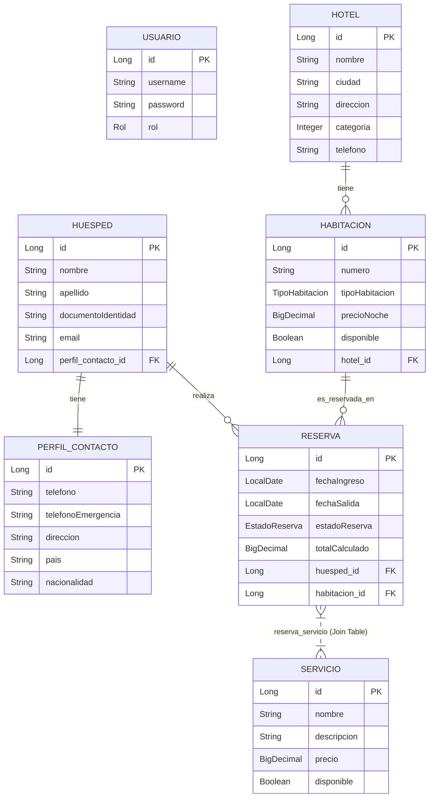

# Sistema de Gestión de Hoteles - API REST

Este proyecto es una **API REST profesional** desarrollada en **Spring Boot** para la administración de un sistema de gestión hotelera. La aplicación permite gestionar hoteles, habitaciones, huéspedes, perfiles de contacto, reservas de habitaciones, servicios adicionales y reportes financieros.

Cuenta con un sistema de seguridad basado en roles (**ADMIN** y **USER**) utilizando **Spring Security** y tokens **JWT (JSON Web Tokens)**, validación de datos de entrada y documentación interactiva de la API con **Swagger/OpenAPI**.

---

## 🛠️ Tecnologías Utilizadas

| Tecnología | Versión | Descripción |
|---|---|---|
| **Java** | 25 | Entorno de ejecución de lenguaje |
| **Spring Boot** | 4.1.0 | Framework base para el desarrollo rápido de aplicaciones |
| **Spring Data JPA** | 4.1.0 | Capa de persistencia y mapeo objeto-relacional (ORM) con Hibernate |
| **Spring Security** | 4.1.0 | Framework de seguridad y control de accesos basado en roles |
| **PostgreSQL** | *Runtime* | Base de datos relacional utilizada para el almacenamiento persistente |
| **Lombok** | *Compile-only*| Librería para reducción de código repetitivo (Boilerplate) |
| **MapStruct** | 1.6.3 | Framework para mapeo automático y eficiente de objetos (DTOs a Entidades) |
| **SpringDoc OpenAPI (Swagger UI)**| 3.0.3 | Generación automática de documentación y consola interactiva de API |
| **JJWT (Java JWT)** | 0.12.5 | Implementación para creación y validación de tokens JWT |
| **JUnit** | 4.13 | Framework para ejecución de pruebas unitarias |
| **Maven** | 3.9+ | Gestor de dependencias y automatización de la construcción del proyecto |

---

## ⚙️ Instrucciones de Instalación Paso a Paso

### 1. Requisitos Previos

Asegúrese de tener instalado en su sistema:

* **JDK 25** (Recomendado Adoptium/Eclipse Temurin)
* **PostgreSQL** local o una instancia en la nube (por ejemplo, [Neon PostgreSQL](https://neon.tech/))
* **Git** para clonar el repositorio
* **Maven** (opcional, el proyecto incluye un Wrapper `mvnw` de Maven)

---

### 2. Clonar el Repositorio

Abra una terminal y ejecute el siguiente comando para clonar el proyecto:

```bash
git clone <URL_DEL_REPOSITORIO>
cd hotel
```

---

### 3. Crear la Base de Datos

Acceda a su cliente de PostgreSQL (pgAdmin, DBeaver o a través de la terminal `psql`) y ejecute la siguiente sentencia SQL para crear la base de datos:

```sql
CREATE DATABASE hotel;
```

---

### 4. Configurar Variables de Entorno y Propiedades

El proyecto utiliza un sistema dinámico de variables de entorno mediante un archivo `.env` que se integra con `application.yaml`.

Cree un archivo llamado `.env` en la **raíz del proyecto** (en el mismo directorio donde está el archivo `pom.xml`) y configure las siguientes variables:

```env
DB_USERNAME=neondb_owner
DB_PASSWORD=tu_contraseña_de_base_de_datos
SECRET=oE03U3p04VAZTEdhCfVRA4Ez3WG6bka3vMf7D27Dtftgei5bRK
```

> [!IMPORTANT]
> Reemplace `DB_USERNAME` y `DB_PASSWORD` con sus credenciales correspondientes de PostgreSQL.
> La propiedad `SECRET` es la firma utilizada para firmar los tokens JWT. Debe ser una cadena segura de al menos 256 bits codificada en Base64.

#### Configuración de `application.yaml`

El archivo de configuración principal se encuentra en `src/main/resources/application.yaml`. A continuación se muestra su estructura de integración:

```yaml
spring:
    application:
        name: hotel

    config:
        import: optional:file:.env[.properties]

    datasource:
        url: jdbc:postgresql://localhost:5432/hotel
        username: ${DB_USERNAME}
        password: ${DB_PASSWORD}
        driver-class-name: org.postgresql.Driver

    jpa:
        hibernate:
            ddl-auto: update
        show-sql: true
        properties:
            hibernate:
                "[format_sql]": true
        database-platform: org.hibernate.dialect.PostgreSQLDialect

server:
    port: 8081

jwt:
    secret: ${SECRET}
    expiration: 86400000 # 24 Horas
```

---

### 5. Compilar y Correr el Proyecto

Desde la raíz del proyecto en la consola, ejecute los siguientes comandos:

**En Linux / macOS:**

```bash
./mvnw clean spring-boot:run
```

**En Windows (PowerShell o CMD):**

```powershell
.\mvnw.cmd clean spring-boot:run
```

El servidor iniciará en el puerto **8081** (<http://localhost:8081>).

---

## 🗂️ Endpoints Disponibles Organizados por Recurso

A continuación se detallan los endpoints REST expuestos por la aplicación. Todos los endpoints que requieren autenticación deben incluir el header `Authorization: Bearer <token>`.

### 🔑 Autenticación (`/api/auth`)

Permite registrar usuarios e iniciar sesión para obtener el token JWT de acceso.

| Método | Endpoint | Descripción | Roles Permitidos |
|---|---|---|---|
| **POST** | `/api/auth/registro` | Registra un nuevo usuario en el sistema. | `PermitAll` |
| **POST** | `/api/auth/login` | Inicia sesión y genera el Token JWT de autorización. | `PermitAll` |

---

### 🏨 Hoteles (`/api/hotel`)

Permite administrar la información principal de los hoteles.

| Método | Endpoint | Descripción | Roles Permitidos |
|---|---|---|---|
| **POST** | `/api/hotel/registar-hotel` | Registra un nuevo hotel. | `ADMIN` |
| **GET** | `/api/hotel` | Obtiene la lista de todos los hoteles. | `ADMIN`, `USER` |
| **GET** | `/api/hotel/buscar/{id}` | Busca un hotel por su ID. | `ADMIN`, `USER` |
| **GET** | `/api/hotel/buscar-por-ciudad/{ciudad}` | Busca hoteles por su ciudad. | `ADMIN`, `USER` |
| **PUT** | `/api/hotel/actualizar/{id}` | Modifica los datos de un hotel. | `ADMIN` |
| **DELETE**| `/api/hotel/{id}` | Elimina el registro de un hotel por su ID. | `ADMIN` |
| **GET** | `/api/hotel/habitaciones-disponibles/{cantidad}` | Lista hoteles con al menos `cantidad` de habitaciones libres. | `ADMIN`, `USER` |
| **GET** | `/api/hotel/listar-hab-hotel/{idHotel}` | Obtiene el hotel y la lista de sus habitaciones asociadas. | `ADMIN`, `USER` |

---

### 🛏️ Habitaciones (`/api/habitacion`)

Permite registrar y buscar habitaciones asignadas a un hotel.

| Método | Endpoint | Descripción | Roles Permitidos |
|---|---|---|---|
| **POST** | `/api/habitacion/asignar-hab-a/{idHotel}` | Registra y asigna una habitación a un hotel específico. | `ADMIN` |
| **GET** | `/api/habitacion` | Obtiene todas las habitaciones registradas. | `ADMIN`, `USER` |
| **GET** | `/api/habitacion/buscar/{id}` | Busca una habitación por su ID. | `ADMIN`, `USER` |
| **PUT** | `/api/habitacion/actualizar/{id}` | Modifica los datos de una habitación. | `ADMIN` |
| **DELETE**| `/api/habitacion/{id}` | Elimina una habitación por su ID. | `ADMIN` |
| **GET** | `/api/habitacion/listar-hab-idHotel/{idHotel}` | Lista las habitaciones disponibles en un hotel determinado. | `ADMIN`, `USER` |
| **GET** | `/api/habitacion/buscar-precio/{precio}` | Busca habitaciones con un precio por noche menor o igual al especificado. | `ADMIN`, `USER` |
| **PATCH** | `/api/habitacion/cambiar-estado-habitacion/{id}` | Alterna el estado de disponibilidad de la habitación. | `ADMIN` |

---

### 👥 Huéspedes (`/api/huesped`)

Administración de huéspedes y sus perfiles de contacto detallados.

| Método | Endpoint | Descripción | Roles Permitidos |
|---|---|---|---|
| **POST** | `/api/huesped/crear-huesped` | Registra un nuevo huésped (incluyendo su perfil de contacto). | `ADMIN` |
| **GET** | `/api/huesped` | Lista todos los huéspedes. | `ADMIN`, `USER` |
| **GET** | `/api/huesped/buscar/{id}` | Busca un huésped por su ID. | `ADMIN`, `USER` |
| **PUT** | `/api/huesped/actualizar/{id}` | Actualiza la información de un huésped. | `ADMIN` |
| **DELETE**| `/api/huesped/{id}` | Elimina un huésped del sistema. | `ADMIN` |
| **GET** | `/api/huesped/buscar-huesped/{nombreApellido}` | Busca huéspedes que coincidan por nombre o apellido. | `ADMIN`, `USER` |
| **GET** | `/api/huesped/datos-huesped-completos/{id}` | Obtiene los datos demográficos y de contacto de un huésped. | `ADMIN`, `USER` |

---

### 🛠️ Servicios (`/api/servicios`)

Servicios adicionales ofrecidos por el hotel (Ej: Spa, Wifi, Gimnasio, Restaurante).

| Método | Endpoint | Descripción | Roles Permitidos |
|---|---|---|---|
| **POST** | `/api/servicios/crear-servicio` | Crea un nuevo servicio adicional. | `ADMIN` |
| **GET** | `/api/servicios` | Obtiene la lista de todos los servicios. | `ADMIN`, `USER` |
| **GET** | `/api/servicios/disponibles` | Lista únicamente los servicios actualmente disponibles. | `ADMIN`, `USER` |
| **GET** | `/api/servicios/buscar/{id}` | Busca un servicio por su ID. | `ADMIN`, `USER` |
| **PUT** | `/api/servicios/actualizar/{id}` | Modifica los datos de un servicio. | `ADMIN` |
| **PATCH** | `/api/servicios/cambiar-estado/{id}` | Alterna el estado de disponibilidad del servicio (Activo/Inactivo). | `ADMIN` |
| **DELETE**| `/api/servicios/{id}` | Elimina un servicio. | `ADMIN` |

---

### 📅 Reservas (`/api/reservas`)

Control del flujo de reserva de habitaciones y consumo de servicios adicionales.

| Método | Endpoint | Descripción | Roles Permitidos |
|---|---|---|---|
| **POST** | `/api/reservas/registrar-reserva` | Registra una nueva reserva para un huésped y habitación. | `ADMIN`, `USER` |
| **GET** | `/api/reservas/reservas-estado-activos` | Obtiene todas las reservas activas (CONFIRMADA, PENDIENTE, COMPLETADA). | `ADMIN`, `USER` |
| **GET** | `/api/reservas/reservas-estado-cancelados` | Obtiene las reservas que han sido canceladas. | `ADMIN`, `USER` |
| **GET** | `/api/reservas/buscar-reserva-id/{id}` | Busca una reserva detallada por su ID. | `ADMIN`, `USER` |
| **PUT** | `/api/reservas/actualizar-reserva/{id}` | Modifica las fechas y parámetros de una reserva. | `ADMIN`, `USER` |
| **PATCH** | `/api/reservas/cancelar-reserva/{id}` | Cancela una reserva existente (cambia estado a CANCELADA). | `ADMIN`, `USER` |
| **GET** | `/api/reservas/listar-huesped-reserva/{idHuesped}` | Lista todas las reservas pertenecientes a un huésped. | `ADMIN`, `USER` |
| **PUT** | `/api/reservas/agregar-servicio-a/reserva-id/{id}` | Agrega una lista de IDs de servicios adicionales a la reserva. | `ADMIN`, `USER` |
| **DELETE**| `/api/reservas/{reservaId}/servicios/{servicioId}` | Elimina un servicio asociado de la reserva. | `ADMIN` |
| **PUT** | `/api/reservas/pago_reserva-id/{id}` | Realiza el pago de la reserva y actualiza su estado. | `ADMIN`, `USER` |

---

### 📊 Reportes (`/api/reportes`)

Sección administrativa para la visualización de métricas financieras.

| Método | Endpoint | Descripción | Roles Permitidos |
|---|---|---|---|
| **GET** | `/api/reportes/total` | Retorna un reporte de texto con los ingresos totales del hotel. | `ADMIN` |

---

## 📖 Instrucciones de Uso de Swagger UI

**Swagger UI** está integrado para facilitar la visualización, exploración interactiva y ejecución de peticiones REST.

1. Inicie la aplicación.
2. Ingrese a la siguiente URL desde el navegador:
   * **[http://localhost:8081/swagger-ui/index.html](http://localhost:8081/swagger-ui/index.html)**
3. Para interactuar con los endpoints protegidos (que requieren roles `ADMIN` o `USER`):
   * Diríjase al recurso `/api/auth/registro` y registre un usuario.
   * Diríjase a `/api/auth/login`, ingrese las credenciales registradas y presione **Execute**.
   * Copie el valor del campo `token` que retorna la respuesta de éxito (sin comillas).
   * En la parte superior derecha de la interfaz de Swagger UI, presione el botón **Authorize** (marcado con un candado).
   * En el cuadro de diálogo que se abre, pegue el token en el campo **Value**.
   * Haga clic en **Authorize** y luego en **Close**.
   * A partir de este momento, todas las solicitudes enviadas a través de Swagger UI incluirán de forma automática el header HTTP `Authorization: Bearer <tu_token_jwt>`.

---

## 📐 Diagrama de Entidades (ERD)

### Visualización Gráfica (Mermaid)



### Representación Textual y Relacional (ASCII)

```text
    +---------------+              +---------------+
    |    Usuario    |              | PerfilContacto|
    +---------------+              +---------------+
    | id (PK)       |              | id (PK)       |
    | username      |              | telefono      |
    | password      |              | tel_emergencia|
    | rol (Enum)    |              | direccion     |
    +---------------+              | pais          |
                                   | nacionalidad  |
                                   +-------+-------+
                                           | 1
                                           | (perfil_contacto_id)
                                           | 1
    +---------------+  1         * +-------v-------+
    |     Hotel     |<------------+  Habitacion   |
    +---------------+ (hotel_id)   +-------+-------+
    | id (PK)       |                      | 1
    | nombre        |                      |
    | ciudad        |                      | (habitacion_id)
    | direccion     |                      |
    | categoria     |                      | *
    | telefono      |              +-------v-------+             +---------------+
    +---------------+              |    Reserva    |* -------- * |   Servicio    |
                                   +-------+-------+             +---------------+
                                           | *                   | id (PK)       |
                                           |                     | nombre        |
                                           | (huesped_id)        | descripcion   |
                                           |                     | precio        |
                                           | 1                   | disponible    |
                                   +-------v-------+             +---------------+
                                   |    Huesped    |
                                   +---------------+
                                   | id (PK)       |
                                   | nombre        |
                                   | apellido      |
                                   | doc_identidad |
                                   | email         |
                                   +---------------+
```

---

## 📝 Ejemplos de JSON para Operaciones Principales

A continuación se listan ejemplos representativos de los payloads JSON requeridos por los endpoints principales.

### 1. Registrar un Usuario (`POST /api/auth/registro`)

```json
{
  "username": "recepcion_admin",
  "password": "PasswordSeguro2026",
  "rol": "ADMIN"
}
```

### 2. Iniciar Sesión (`POST /api/auth/login`)

```json
{
  "username": "recepcion_admin",
  "password": "PasswordSeguro2026"
}
```

### 3. Registrar un Hotel (`POST /api/hotel/registar-hotel`)

*Requiere rol `ADMIN`.*

```json
{
  "nombre": "Hotel Antigravity Plaza",
  "ciudad": "Bogotá",
  "direccion": "Calle 26 # 69-70",
  "categoria": 5,
  "telefono": "+576014445555"
}
```

### 4. Registrar y Asignar Habitación (`POST /api/habitacion/asignar-hab-a/{idHotel}`)

*Asigna una habitación a un hotel existente por su ID en la URL. Requiere rol `ADMIN`.*

```json
{
  "numero": "404-SUITE",
  "tipoHabitacion": "SUITE",
  "precioNoche": 289.90
}
```

### 5. Registrar un Huésped con Perfil (`POST /api/huesped/crear-huesped`)

*Requiere rol `ADMIN`.*

```json
{
  "nombre": "Carlos",
  "apellido": "Mendoza",
  "documentoIdentidad": "CC-10203040",
  "email": "carlos.mendoza@email.com",
  "perfilContacto": {
    "telefono": "+573155559988",
    "telefonoEmergencia": "+573155551122",
    "direccion": "Carrera 7 # 72-10",
    "pais": "Colombia",
    "nacionalidad": "Colombiana"
  }
}
```

### 6. Registrar un Servicio Adicional (`POST /api/servicios/crear-servicio`)

*Requiere rol `ADMIN`.*

```json
{
  "nombre": "Spa Termal",
  "descripcion": "Acceso al circuito hídrico y masaje relajante de 45 minutos",
  "precio": 45.00
}
```

### 7. Registrar una Reserva (`POST /api/reservas/registrar-reserva`)

*Registra la reserva calculando automáticamente la tarifa total basada en noches hospedadas. Permite opcionalmente inyectar una lista de IDs de servicios consumidos. Requiere rol `ADMIN` o `USER`.*

```json
{
  "fechaIngreso": "2026-08-01",
  "fechaSalida": "2026-08-05",
  "huespedId": 1,
  "habitacionId": 1,
  "serviciosId": [1]
}
```

### 8. Agregar Servicios a una Reserva (`PUT /api/reservas/agregar-servicio-a/reserva-id/{id}`)

*Añade servicios adicionales a una reserva en curso mediante una lista de IDs en el cuerpo de la petición. Requiere rol `ADMIN` o `USER`.*

```json
[
  1,
  2
]
```
